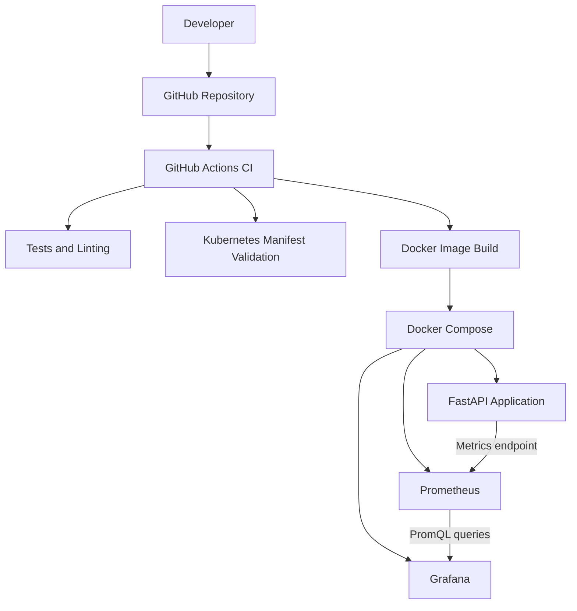

# CLOUDPULSE — DevOps & Infrastructure Monitoring Platform

[](https://github.com/kanika13-2/cloudpulse-devops-platform/actions)


CloudPulse is a DevOps portfolio project demonstrating containerized application deployment, automated CI workflows, Kubernetes configuration, and infrastructure monitoring using Prometheus and Grafana.

The project combines a Python FastAPI application with Docker Compose, monitoring tools, automated testing, and GitHub Actions.

## Project Overview

CloudPulse demonstrates how an application can be packaged, tested, monitored, and prepared for cloud deployment using commonly used DevOps tools.

### Implemented and locally verified

- FastAPI application with health and system-information endpoints.
- Prometheus metrics endpoint and custom application metrics.
- Docker containerization and Docker Compose orchestration.
- Prometheus scraping application metrics.
- Grafana dashboards for API availability, memory usage, and simulated errors.
- Structured application logging and health checks.
- GitHub Actions CI pipeline for testing, linting, Kubernetes manifest validation, and Docker image builds.
- Automated application tests.

### Infrastructure configuration prepared

- Kubernetes Deployment, Service, ConfigMap, Secret template, HPA, PDB, ServiceAccount, and Ingress manifests.
- AWS IAM OIDC and ECR configuration.
- AWS deployment workflow configuration.
- CloudWatch monitoring configuration files.

**Deployment status:** The application and monitoring stack have been tested locally. Kubernetes manifests have passed CI validation, but a working Kubernetes cluster deployment and AWS EKS deployment are still pending.

## Architecture



The AWS and Kubernetes deployment configuration is prepared separately and is not represented as a completed live deployment.

## Technology Stack

| Category | Technologies |
|---|---|
| Programming | Python |
| API Framework | FastAPI |
| Containerization | Docker |
| Orchestration | Docker Compose |
| Monitoring | Prometheus |
| Visualization | Grafana |
| CI/CD | GitHub Actions |
| Container Orchestration Configuration | Kubernetes |
| Cloud Configuration | AWS IAM, ECR, EKS, CloudWatch |
| Testing | Pytest |
| Version Control | Git, GitHub |

## Repository Structure

```text
cloudpulse-devops-platform/
├── .github/
│   └── workflows/
│       ├── ci-cd.yml
│       └── pr-check.yml
├── app/
│   ├── main.py
│   ├── config.py
│   ├── logger.py
│   ├── metrics.py
│   ├── models.py
│   └── routers/
├── docs/
├── k8s/
│   ├── 00-namespace.yaml
│   ├── 01-configmap.yaml
│   ├── 02-secret.yaml
│   ├── 03-deployment.yaml
│   ├── 04-service.yaml
│   ├── 05-hpa.yaml
│   ├── 06-pdb.yaml
│   ├── 07-serviceaccount.yaml
│   └── 08-ingress.yaml
├── monitoring/
│   ├── prometheus/
│   ├── grafana/
│   └── cloudwatch/
├── scripts/
│   ├── linux/
│   └── windows/
├── tests/
├── docker-compose.yml
├── Dockerfile
├── requirements.txt
├── requirements-dev.txt
├── pytest.ini
└── TASK_STATUS.md
```

## Local Setup

### Prerequisites

- Python 3.12 or compatible version
- Docker Desktop
- Git

### Clone the repository

```bash
git clone https://github.com/kanika13-2/cloudpulse-devops-platform.git
cd cloudpulse-devops-platform
```

### Start the monitoring stack

```bash
docker compose up -d --build
```

### Check running containers

```bash
docker ps
```

### Access application services

| Service | URL |
|---|---|
| FastAPI Application | http://localhost:8000 |
| Swagger API Documentation | http://localhost:8000/docs |
| Application Health | http://localhost:8000/health |
| Prometheus Metrics | http://localhost:8000/metrics |
| Prometheus Dashboard | http://localhost:9090 |
| Grafana Dashboard | http://localhost:3000 |

Grafana's initial credentials depend on the local configuration. Check your Docker Compose configuration before logging in.

### Stop the stack

```bash
docker compose down
```

This command does not remove named volumes.

## Monitoring and Observability

CloudPulse uses Prometheus to collect application metrics and Grafana to visualize them.

### Verified Grafana panels

1. **API Availability:** Displays whether the CloudPulse API is available.
2. **Memory Usage:** Displays application memory usage over time.
3. **Simulated Errors:** Displays the accumulated simulated error counter.

### Prometheus metrics

Examples of monitored metrics include:

- `cloudpulse_memory_usage_percent`
- `cloudpulse_simulated_errors_total`

Prometheus targets for both the CloudPulse API and Prometheus were verified as UP.

### Simulated error testing

Trigger a test error using PowerShell:

```powershell
try {
    Invoke-RestMethod http://localhost:8000/api/v1/simulate/error
} catch {
    Write-Host "HTTP status:" $_.Exception.Response.StatusCode
}
```

Query the error counter:

```powershell
$r = Invoke-RestMethod "http://localhost:9090/api/v1/query?query=cloudpulse_simulated_errors_total"
$r.data.result | ForEach-Object {
    Write-Host "Metric:" $_.metric.__name__
    Write-Host "Value:" $_.value[1]
}
```

This allows the simulated error metric to be checked independently of the HTTP response.

## CI/CD Pipeline

The GitHub Actions workflow is located at:

`.github/workflows/ci-cd.yml`

The verified CI pipeline includes:

1. Automated tests and linting.
2. Kubernetes manifest validation.
3. Docker image build and verification.
4. Conditional AWS deployment job.

### Latest verified pipeline

| Job | Result |
|---|---|
| Test & Lint | Passed |
| Validate Kubernetes Manifests | Passed |
| Build & Verify Docker Image | Passed |
| Deploy to AWS ECR & EKS | Skipped |

The latest successful workflow completed in approximately 1 minute 47 seconds.

AWS deployment remains inactive to avoid cloud infrastructure charges during development.

## Testing and Validation

Previously verified local test results:

- 13 automated tests passed.
- 93% code coverage.
- Black formatting checks passed.
- Flake8 lint checks passed.
- Kubernetes manifest validation passed in GitHub Actions.

These results describe the recorded test and CI runs; they do not imply a live Kubernetes or AWS deployment.

## Kubernetes Configuration

The `k8s/` directory contains configuration for:

- Namespace
- ConfigMap
- Secret template
- Application Deployment
- Service
- Horizontal Pod Autoscaler
- Pod Disruption Budget
- ServiceAccount
- Ingress

The manifests are included for future Kubernetes deployment. Actual cluster-based rollout, autoscaling, and self-healing tests remain pending.

## AWS Deployment Readiness

AWS-related configuration has been prepared for:

- IAM OIDC authentication for GitHub Actions.
- Amazon ECR container image storage.
- Amazon EKS deployment.
- CloudWatch monitoring configuration.

The AWS deployment workflow has not been executed against a live EKS cluster. No production deployment is claimed.

## Future Improvements

- Deploy and test on a Kubernetes cluster.
- Verify pod self-healing and HPA scaling.
- Complete AWS ECR and EKS deployment.
- Integrate and verify CloudWatch monitoring.
- Add alerting and notification workflows.
- Improve Grafana dashboard coverage.

## Documentation

Additional project documentation:

- [Architecture](docs/ARCHITECTURE.md)
- [AWS EKS Guide](docs/AWS_EKS_GUIDE.md)
- [CloudWatch Setup](monitoring/cloudwatch/CLOUDWATCH_SETUP.md)
- [Troubleshooting](docs/TROUBLESHOOTING.md)
- [Interview Preparation](docs/INTERVIEW_PREP.md)
- [Task Status](TASK_STATUS.md)

## License

This project is distributed under the license specified in the repository's `LICENSE` file.

---

**CloudPulse — Building, Testing, and Monitoring Cloud-Ready Applications with DevOps Practices.**