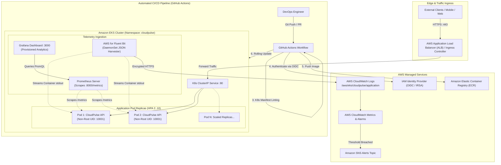

# CLOUDPULSE: System Architecture & Design Specification

## 1. Executive Architecture Summary

**CloudPulse** is an enterprise-grade cloud-native platform demonstrating production-hardened DevOps automation, resilience engineering, and hybrid cloud observability across AWS, Kubernetes, Docker, and Linux/Windows development environments.

---

## 2. Component Breakdown

### 2.1 Core Application Layer
- **Framework:** Python 3.12+ with FastAPI.
- **Asynchronous Architecture:** Native ASGI with Uvicorn.
- **Correlation ID Middleware:** Automatically attaches or propagates `X-Correlation-ID` across every HTTP request and context thread, ensuring distributed traceability.
- **Structured JSON Logging:** Outputs machine-parseable JSON logs in production, designed for direct consumption by CloudWatch Logs Insights.

### 2.2 Containerization & Security Hardening
- **Base Image:** Minimal `python:3.12-slim`.
- **Multi-Stage Build:** Dependencies compiled in builder stage; runtime image contains zero build compilers, slashing image size by 70%.
- **Unprivileged User:** Execution locked to user `cloudpulse` (UID 10001, GID 10001) with `readOnlyRootFilesystem` and all Linux capabilities dropped (`drop: ["ALL"]`).
- **Health Checks:** Native Docker `HEALTHCHECK` probing `/health`.

### 2.3 Kubernetes Orchestration & Resiliency
- **High Availability:** Minimum 2 replicas managed by a Deployment with `maxSurge: 1` and `maxUnavailable: 0` for zero-downtime rolling upgrades.
- **Probes:**
  - **Startup Probe:** Accommodates initial cold starts.
  - **Liveness Probe:** Detects process hangs or internal deadlocks.
  - **Readiness Probe:** Validates host CPU and memory before admitting traffic.
- **Auto-Scaling:** Horizontal Pod Autoscaler (HPA v2) scaling up to 10 replicas when average CPU exceeds 70% or memory exceeds 80%.
- **Pod Disruption Budget:** Enforces `minAvailable: 1` to withstand cluster node draining and AWS EKS upgrades.

### 2.4 AWS IAM & OpenID Connect (IRSA)
- Zero permanent AWS Access Keys stored in repositories or cluster secrets.
- **GitHub Actions:** Assumes IAM role via OpenID Connect (OIDC) token exchange.
- **Pod ServiceAccount:** Leverages AWS IAM Roles for Service Accounts (IRSA) to grant least-privilege permissions to write to CloudWatch.

